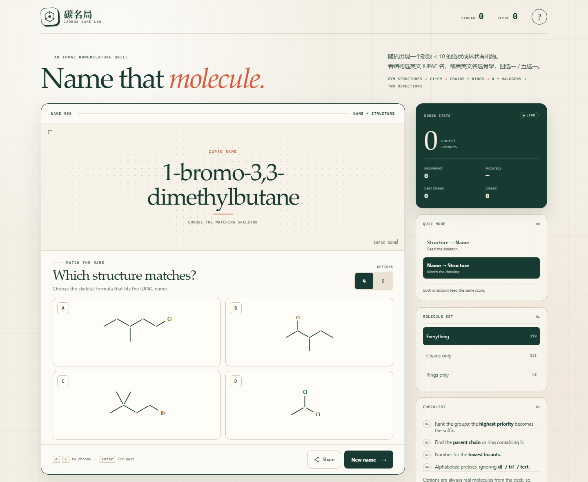

# 碳名局 · Carbon Name Lab

一个无需构建、无需外部依赖的 IUPAC 命名练习网站。随机生成碳数少于 10 的链状、环状或芳香族有机物，可以：

- **Structure → Name**：看骨架，从 4/5 个英文 IUPAC 名称中选正确答案
- **Name → Structure**：看英文名，从 4/5 个骨架中选正确结构
- 一键分享当前题目；手机调用系统分享面板，桌面复制挑战链接
- 命名规则、官能团优先级、计分、连续答对、链/环筛选
- 题库：**279 个结构**，全部 C1–C9，含多卤代、卤代胺、卤代氨基酸、卤代酰胺/腈/醚、环胺等复杂取代基

## Online

<https://diqie6.github.io/>

## Local preview

```powershell
python -m http.server 8787 --bind 127.0.0.1
```

Then open <http://127.0.0.1:8787/>.

## Notes

- No build step and no CDN dependencies; all structures are rendered as inline SVG.
- Constitutional nomenclature only; E/Z and R/S descriptors are intentionally omitted.
- The share URL uses the current origin. A local `127.0.0.1` link only works on that machine; the deployed GitHub Pages URL works publicly.


